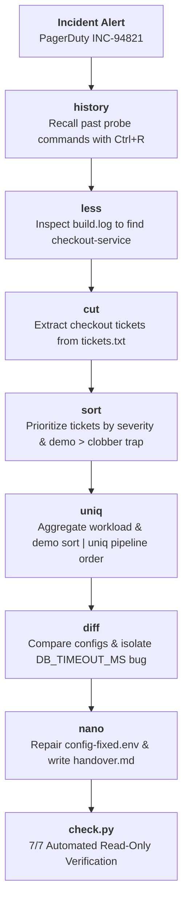

# Tech Lab 2: Terminal Tooling & SRE Incident Handover

[](https://codespaces.new/prakashm121/terminal-lab-release-handover?quickstart=1)

> **Course:** Software Engineering Tools & Systems  
> **Module:** Core Unix Terminal Environments  
> **Topic:** `history`, `nano`, `less`, `sort`, `uniq`, `cut`, `diff`  
> **Scenario:** CloudRetail SRE Incident Response — Canary Release Outage (#INC-94821)  
> **Student Guide:** [`book/lab-book.pdf`](book/lab-book.pdf) (9 Pages)  
> **Checker:** `lab/check.py` — auto-hints on failure, visual score card, strict read-only  
> **Reset:** `lab/reset.py` — wipe & re-scaffold any attempt without losing your attempt number

---

## 🚀 Quickstart in 60 Seconds

### 1. Launch Environment
Open this repository in a GitHub Codespace or clone it into any Linux/Ubuntu terminal with `bash`, `nano`, and `less` installed.

### 2. Initialize a Fresh Attempt
To create a clean, isolated workspace that **never** overwrites existing work:
```bash
python lab/start.py    # Or in bash: bash lab/start.sh
```
*Output:*
```text
==================================================================
  [SUCCESS] Initialized fresh lab workspace: attempt-1
==================================================================
  Workspace path: lab-work/attempt-1
  To begin working, run:
    cd lab-work/attempt-1
```

### 3. Work Through the Student Booklet
Follow the step-by-step instructions in [`book/lab-book.pdf`](book/lab-book.pdf) or [`book/lab-book.md`](book/lab-book.md).

### 4. Verify Your Work (Read-Only)
At any point during the lab, test your progress:
```bash
cd lab-work/attempt-1
python3 ../../lab/check.py
```
The checker is **strictly read-only** and provides:
- ✦ A **styled hint block** under every failing check (word-wrapped, arrow-prefixed)
- ✦ A **visual progress bar** and **score card** at the end (`Score: 6/7  ██████████░░░░░░  85%`)

### 5. Need to Start Fresh? (Reset Without Losing Your Attempt Number)
To wipe all student-generated files and restore clean fixtures in the **same** attempt directory:
```bash
python3 lab/reset.py
```
The script shows exactly which files will be deleted and requires typing **`yes`** to confirm. Your attempt number is preserved.

---

## 📂 Repository Layout

```text
├── .devcontainer/
│   ├── devcontainer.json        # Codespace environment configuration
│   └── Dockerfile               # Ubuntu 22.04 image with nano, less, coreutils
├── .github/workflows/
│   └── verify.yml               # Automated GitHub Actions CI workflow
├── book/
│   ├── lab-book.md              # Complete 9-page student guide source
│   ├── build_booklet.py         # Automated PDF generator
│   └── lab-book.pdf             # Formatted 9-page student booklet PDF
├── lab/
│   ├── data/                    # Read-only original incident fixtures
│   │   ├── build.log            # 180-line CI/CD build & deployment log
│   │   ├── tickets.txt          # Pipe-delimited Jira incident database
│   │   ├── config-v1.env        # Stable v2.4.0 production configuration
│   │   ├── config-v2.env        # Broken v2.4.1 canary configuration
│   │   └── handover.md.template # Handover report template
│   ├── start.py                 # Scaffold a fresh attempt-N workspace
│   ├── start.sh                 # Shell wrapper for start.py
│   ├── check.py                 # Read-only checker: per-fail hints + score card
│   ├── check.sh                 # Shell wrapper for check.py
│   ├── reset.py                 # Wipe & re-scaffold an attempt (preserves attempt number)
│   ├── test_suite.py            # 1-command local regression test runner
│   ├── solution/
│   │   └── solve.py             # Reference solution generator in Python
│   └── demo-broken/             # Deliberately broken state for Loom video demo
│       ├── fix-demo.py          # Python fix script for demo
│       └── README.md            # Demo narration instructions
├── scripts/
│   ├── verify_environment.py    # Pre-flight environment verifier
│   └── verify_environment.sh    # Pre-flight shell wrapper
├── REVIEWER_NOTES.md            # Solutions, tool-to-experiment map, 3 improvements
└── README.md
```

---

## 🎯 Pedagogical Concept Map

Every tool is taught as part of a single, realistic DevOps incident triage workflow:



---

## 🛡️ Critical Traps Covered Hands-On

1. **The Same-File Redirection Trap (`sort file > file`):**
   - Students learn why shell output redirection truncates files to 0 bytes via `O_TRUNC` before `sort` executes.
   - Tested safely in an isolated `sandbox/` directory.
   - Teaches the two safe solutions: temporary file swap and `sort -o file file`.

2. **Pipeline Order Sensitivity (`sort | uniq` vs `uniq | sort`):**
   - Students observe that `uniq` operates strictly on **adjacent** lines.
   - Tested on unsorted assignee names to see un-aggregated duplicates slip through.
   - Demonstrates why Unix pipelines are not commutative.

---

## 🛠️ Developer & Instructor Commands

- **Rebuild PDF Booklet:**
  ```bash
  python3 book/build_booklet.py
  ```
- **Initialize a fresh student attempt:**
  ```bash
  python3 lab/start.py
  ```
- **Run automated reference solution + verify:**
  ```bash
  python3 lab/start.py
  python3 lab/solution/solve.py lab-work/attempt-1
  python3 lab/check.py lab-work/attempt-1
  ```
- **Reset an attempt to a clean state:**
  ```bash
  python3 lab/reset.py                        # resets latest attempt
  python3 lab/reset.py lab-work/attempt-2    # resets a specific attempt
  ```
- **Run validation on the broken demo state:**
  ```bash
  python3 lab/check.py lab/demo-broken
  ```
- **Run local regression test suite:**
  ```bash
  python3 lab/test_suite.py
  ```
